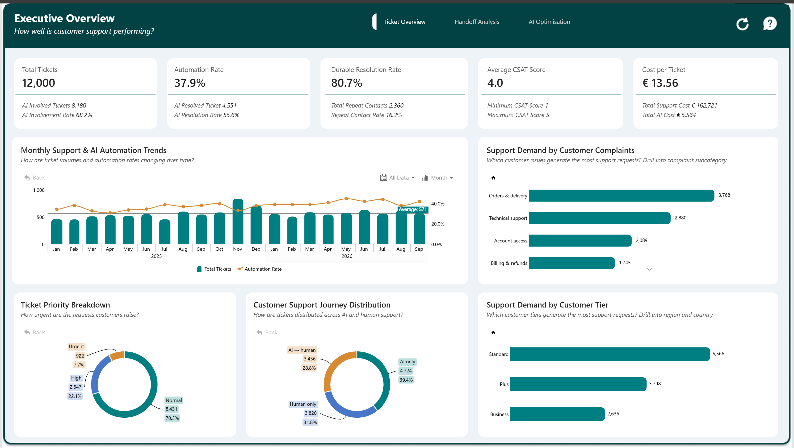
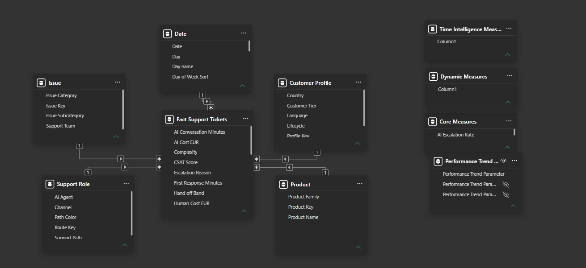

# AI-Powered Customer Support Optimisation

A Power BI analysis that examines how effectively AI-powered customer support resolves issues, why AI conversations require human intervention, and where businesses can improve automation, resolution quality, and cost efficiency without compromising customer satisfaction.

## Live Dashboard

[View the Interactive Power BI Report](https://app.powerbi.com/view?r=eyJrIjoiMDE5N2VkYmMtM2YxMC00N2JhLWI0OWUtYmE2Y2I0ZDdiOTQyIiwidCI6IjQ2NTRiNmYxLTBlNDctNDU3OS1hOGExLTAyZmU5ZDk0M2M3YiIsImMiOjl9)

## Business Question

**How can customer support leaders optimise AI automation and human handoffs to deliver lasting resolutions, maintain customer satisfaction and reduce support costs?**

The analysis is structured around three management questions:

**How well is support performing? → Why does AI require human assistance? → Where should support operations improve?**

## Key Findings

- **AI adoption is substantial, but independent resolution is more limited:** AI was involved in 8,180 of 12,000 tickets (68.2%). Of these, 4,551 were resolved independently by AI, representing an AI resolution rate of 55.6% and a successful automation rate of 37.9% across all tickets.

- **Handoffs are frequent and associated with weaker resolution outcomes:** 3,456 AI-supported tickets (42.2%) required human intervention. Handoff journeys achieved a 70.1% durable resolution rate, compared with 86.7% for AI-only journeys.

- **Repeat contacts present a customer experience challenge:** Escalated tickets recorded a 26.0% repeat-contact rate, compared with 10.9% for AI-only tickets, highlighting differences in lasting resolution quality.

- **Low AI confidence is the leading recorded reason for escalation:** Low answer confidence accounted for 844 handoffs, followed by customer-requested human assistance (808). These represent different opportunities for improving AI capabilities and support routing.

- **Technical and billing issues warrant targeted investigation:** Integration errors recorded an 84.5% handoff rate and €74.05 cost per durable resolution. Billing disputes recorded a 90.2% handoff rate and €62.53 cost per durable resolution.

- **Human handling dominates overall support expenditure:** Total support costs reached €162,721.50, comprising €128,461.52 in human handling, €28,696.36 in repeat-contact costs and €5,563.62 in AI costs. AI-to-human journeys accounted for €93,631.23 of total expenditure.

## Dashboard

### 1. Executive Overview

**How well is customer support performing?**

Provides management with an overview of support demand, automation, durable resolution, customer satisfaction and cost efficiency.

The report explores ticket trends, customer complaints, ticket priority, support journeys and customer segments.

### 2. Handoff Analysis

**Why does AI require human assistance, and how do handoffs relate to customer outcomes?**

Investigates why AI-to-human escalations happen and how handoff frequency, issue complexity, resolution quality, and customer experience relate.

The analysis identifies customer issues with frequent escalations and examines waiting times and satisfaction across language groups.

### 3. AI Optimisation & Costs

**Where can we improve AI effectiveness, resolution quality and cost efficiency?**

Examines opportunities to improve independent AI resolution while maintaining customer satisfaction and controlling support expenditure.

The analysis connects AI resolution quality, channel performance, support cost composition, product-level costs and repeat-contact expenditure.

## Dataset

It contains 12,000 customer support tickets created between January 2025 and September 2026.

## Data Modelling

The Power BI semantic model follows a **star-schema structure**, consisting of one ticket-level fact table and five dimension tables.

The model uses one-to-many relationships with single-direction filtering from dimensions to the fact table.

Reusable DAX measures support KPI calculations, while ZoomCharts visuals provide interactive filtering and hierarchical drill-down.

## Business Recommendations

1. **Prioritise high-handoff customer issues.** Investigate billing disputes and integration errors to understand whether knowledge gaps, AI capability limitations or routing policies contribute to frequent escalations.

2. **Improve AI confidence and escalation decisions.** Review low-confidence responses and missing-knowledge scenarios to identify opportunities for improving AI knowledge coverage while preserving appropriate human intervention.

3. **Strengthen lasting resolution quality.** Monitor durable resolution and repeat-contact rates alongside automation performance to ensure efficiency improvements do not compromise customer outcomes.

4. **Optimise costly support journeys.** Investigate AI-to-human interactions with high handling and repeat-contact costs, focusing on opportunities to improve routing efficiency and reduce unnecessary support effort.

5. **Target improvement opportunities using customer and issue context.** Evaluate automation effectiveness across products, issue complexity, channels and customer segments before recommending changes to AI routing.

6. **Balance efficiency with customer satisfaction.** Use resolution quality, CSAT and cost per ticket together when assessing the value of AI-powered support rather than relying on automation rates alone.

These recommendations identify evidence-based opportunities for further investigation, not confirmed financial savings or causal effects.

## Tools & Skills

**Power BI · DAX · Power Query · Star Schema · Data Modelling · ZoomCharts · Data Visualisation · KPI Development · Business Analysis · Interactive Drill-Down · Customer Experience Analysis · Data Storytelling**

## Full Case Study

[Read the Full AI-Powered Customer Support Optimisation Case Study](Documentation/Case_Study.pdf)

---

**Note:** This project uses a synthetic challenge dataset. Findings illustrate analytical patterns and decision-making opportunities rather than verified outcomes from a live customer support organisation. Observed relationships do not establish causation.
